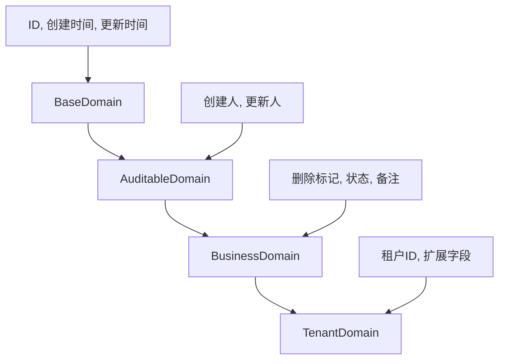

# itsuka-mybatis-plus-spring-boot-starter

基于MyBatis-Plus的增强Starter，提供数据权限控制、自动填充、自定义SQL注入、实体基类等企业级功能。

## 🎯 核心功能

### 🔐 数据权限控制
- 基于创建人的数据权限拦截
- 支持表级别的权限排除配置
- 可配置权限逃离机制
- 自动识别create_by字段

### ⚡ 自动填充字段
- 自动填充创建时间/更新时间
- 自动填充创建人/更新人
- 基于当前登录用户信息

### 🏗️ 实体基类体系
- `BaseDomain` - 基础实体（ID、时间字段）
- `AuditableDomain` - 审计实体（添加创建人、更新人）
- `BusinessDomain` - 业务实体（添加删除标记、状态）
- `TenantDomain` - 多租户实体（添加租户ID、扩展字段）

### 🔧 自定义SQL注入
- 扩展MyBatis-Plus内置方法
- 提供`selectValueRange`方法用于字段值去重查询

### 📄 分页增强
- 集成MyBatis-Plus分页插件
- 支持物理分页
- 自定义分页对象，简化前后端交互

## 🚀 快速开始

### 1. 添加依赖

```gradle
dependencies {
    implementation 'org.itsuka:itsuka-mybatis-plus-spring-boot-starter:1.0.0'
}
```

### 2. 配置说明

```yaml
spring:
  datasource:
    url: jdbc:mysql://localhost:3306/your-database
    username: your-username
    password: your-password
    driver-class-name: com.mysql.cj.jdbc.Driver

mybatis-plus:
  mapper-locations: classpath:/mapper/**/*.xml
  global-config:
    db-config:
      id-type: assign_id
      logic-delete-field: deleted
      logic-delete-value: 1
      logic-not-delete-value: 0
  configuration:
    map-underscore-to-camel-case: true

itsuka:
  mybatis-plus:
    enable: true  # 启用增强功能
    data-permission:
      exclude-tables: ["sys_log", "sys_config"]  # 排除数据权限的表
      user-table-name: "user"  # 用户表名
      must-contain-create-by: false  # 是否必须包含create_by字段
      create-by-field: "create_by"  # 创建人字段名
```

### 3. 使用示例

#### 实体类定义

```java
// 使用业务实体基类
@Data
@EqualsAndHashCode(callSuper = true)
@TableName("sys_user")
public class SysUser extends BusinessDomain {
    
    @TableField("username")
    private String username;
    
    @TableField("password")
    private String password;
    
    @TableField("email")
    private String email;
    
    @TableField("phone")
    private String phone;
    
    @TableField("dept_id")
    private Long deptId;
}

// 使用多租户实体基类
@Data
@EqualsAndHashCode(callSuper = true)
@TableName("sys_order")
public class SysOrder extends TenantDomain {
    
    @TableField("order_no")
    private String orderNo;
    
    @TableField("amount")
    private BigDecimal amount;
}
```

#### Mapper定义

```java
@Mapper
public interface SysUserMapper extends BaseMapper<SysUser> {
    // 继承了所有基础CRUD方法
    // 也可以使用自定义注入的方法
    
    /**
     * 查询某个字段的所有值（去重）
     */
    List<Object> selectValueRange(@Param("col") String column, @Param(Constants.WRAPPER) Wrapper<SysUser> queryWrapper);
}
```

#### Service定义

```java
@Service
public class SysUserService extends ServiceImpl<SysUserMapper, SysUser> {
    
    @Autowired
    private DataPermissionEscaper escaper;
    
    /**
     * 创建用户（自动填充字段）
     */
    public boolean createUser(SysUser user) {
        // 自动填充create_time、update_time、create_by、update_by
        return save(user);
    }
    
    /**
     * 更新用户（会检查数据权限）
     */
    public boolean updateUser(SysUser user) {
        // 只能更新当前用户创建的数据
        return updateById(user);
    }
    
    /**
     * 管理员更新（绕过数据权限检查）
     */
    public boolean adminUpdateUser(SysUser user) {
        return escaper.executeWithoutPermission(() -> updateById(user));
    }
    
    /**
     * 获取所有部门ID（去重）
     */
    public List<Object> getAllDeptIds() {
        return baseMapper.selectValueRange("dept_id", Wrappers.emptyWrapper());
    }
}
```

## 🔧 高级功能

### 数据权限控制

数据权限拦截器会自动拦截UPDATE和DELETE操作，确保用户只能操作自己创建的数据：

```java
// 正常情况下，只能更新当前用户创建的数据
UserEntity user = new UserEntity();
user.setId(1L);
user.setUsername("newName");
userService.updateById(user);  // 会检查create_by字段

// 使用权限逃离器，绕过数据权限检查
escaper.executeWithoutPermission(() -> {
    return userService.updateById(user);  // 不会检查数据权限
});
```

### 自动填充机制

自动填充处理器会在新增和更新时自动填充字段：

```java
@TableField(value = "create_time", fill = FieldFill.INSERT)
private LocalDateTime createTime;

@TableField(value = "update_time", fill = FieldFill.INSERT_UPDATE)
private LocalDateTime updateTime;

@TableField(value = "create_by", fill = FieldFill.INSERT)
private String createBy;

@TableField(value = "update_by", fill = FieldFill.INSERT_UPDATE)
private String updateBy;
```

### 实体类层次结构



### 自定义SQL注入

扩展MyBatis-Plus的内置方法：

```java
// 自定义SQL注入器会自动注入以下方法到所有Mapper中

/**
 * 查询某个字段的所有值（去重）
 * @param column 字段名
 * @param queryWrapper 查询条件
 * @return 字段值列表
 */
List<Object> selectValueRange(@Param("col") String column, @Param(Constants.WRAPPER) Wrapper<T> queryWrapper);
```

### 自定义分页对象

为了简化前后端交互，我们创建了自定义的分页对象 `PageParam` 和 `PageResult`，用于替换 MyBatis Plus 的 `Page` 对象在接口层的暴露。

#### 架构设计

```
前端请求 → Controller (PageParam/PageResult) → Service (PageParam/PageResult) → ServiceImpl (内部使用MyBatis Plus Page) → 数据库
```

- **Controller/Service 接口层**: 使用自定义的 PageParam 和 PageResult
- **ServiceImpl 实现层**: 内部使用 MyBatis Plus Page，通过 PageUtil 转换

#### 对象说明

##### PageParam - 分页参数

```java
@Data
public class PageParam {
    private Long current = 1L;  // 当前页码，从1开始
    private Long size = 10L;    // 每页大小
}
```

##### PageResult - 分页结果

```java
@Data
public class PageResult<T> {
    private List<T> records;  // 数据列表
    private Long current;     // 当前页码
    private Long size;        // 每页大小
    private Long total;       // 总记录数
    private Long pages;       // 总页数
}
```

#### 使用方法

##### 1. Controller 层

```java
@RestController
public class UserController {
    
    @GetMapping("/page")
    public Response<PageResult<User>> page(PageParam pageParam, UserQueryCriteria criteria) {
        return Response.success(userService.pageUser(pageParam, criteria));
    }
}
```

##### 2. Service 接口层

```java
public interface UserService {
    PageResult<User> pageUser(PageParam pageParam, UserQueryCriteria criteria);
}
```

##### 3. ServiceImpl 实现层

```java
@Service
public class UserServiceImpl implements UserService {
    
    @Override
    public PageResult<User> pageUser(PageParam pageParam, UserQueryCriteria criteria) {
        // 转换为 MyBatis Plus 的 Page 对象
        Page<User> page = page(PageUtil.toPage(pageParam), getWrapper(criteria));
        // 转换回 PageResult
        return PageUtil.toResult(page);
    }
}
```

#### 工具类 PageUtil

```java
// 基础转换
Page<User> mybatisPage = PageUtil.toPage(pageParam);

// 带排序的转换
Page<User> mybatisPage = PageUtil.toPage(pageParam, "createTime", false);

// 将 MyBatis Plus Page 转换为 PageResult
PageResult<User> result = PageUtil.toResult(mybatisPage);
```

#### 前端交互格式

##### 请求参数
```json
{
  "current": 1,
  "size": 10
}
```

##### 响应结果
```json
{
  "code": 200,
  "message": "success",
  "data": {
    "records": [...],
    "current": 1,
    "size": 10,
    "total": 100,
    "pages": 10
  }
}
```

#### 分页功能优势

1. **简化交互**: 只包含前后端需要的必要字段
2. **统一规范**: 所有分页接口使用相同的分页对象
3. **易于扩展**: 可以根据需要添加额外的分页相关字段
4. **向后兼容**: 内部仍使用 MyBatis Plus Page，保持性能
5. **清晰分层**: 接口层使用自定义对象，实现层使用原生对象

#### 迁移指南

1. 将 Controller 中的 `Page<Entity>` 替换为 `PageParam` 参数和 `PageResult<Entity>` 返回值
2. 更新 Service 接口和实现类
3. 使用 `PageUtil` 工具类进行对象转换
4. 更新相关的测试用例
5. ServiceImpl 中保留 MyBatis Plus Page 的导入，因为内部仍需要使用

#### 分页注意事项

- ServiceImpl 实现类中仍需要导入 `com.baomidou.mybatisplus.extension.plugins.pagination.Page`，因为需要使用 MyBatis Plus 的 `page()` 方法
- 转换逻辑集中在 PageUtil 工具类中，便于维护和统一修改
- 自定义分页对象放置在 mybatis-plus-starter 中，便于其他模块复用

## 📋 配置参数详解

### 数据权限配置

| 参数 | 默认值 | 说明 |
|------|---------|------|
| `itsuka.mybatis-plus.data-permission.exclude-tables` | `[]` | 排除数据权限检查的表名列表 |
| `itsuka.mybatis-plus.data-permission.user-table-name` | `"user"` | 用户表名称 |
| `itsuka.mybatis-plus.data-permission.must-contain-create-by` | `false` | 是否必须包含create_by字段 |
| `itsuka.mybatis-plus.data-permission.create-by-field` | `"create_by"` | 创建人字段名称 |

## 📚 依赖模块

- `mybatis-plus-boot-starter` - MyBatis-Plus基础功能
- `itsuka-spring-boot-starter` - 核心工具类
- `itsuka-web-spring-boot-starter` - Web工具类

## ⚠️ 注意事项

1. **数据权限限制**：
   - 只对UPDATE和DELETE操作生效
   - 需要表中包含create_by字段
   - 可通过exclude-tables排除指定表

2. **自动填充前提**：
   - 需要当前用户已登录
   - 字段必须配置相应的`@TableField`注解

3. **实体类选择**：
   - 简单实体使用`BaseDomain`
   - 需要审计功能使用`AuditableDomain`
   - 业务实体使用`BusinessDomain`
   - 多租户系统使用`TenantDomain`

4. **性能考虑**：
   - 数据权限拦截器会增加额外查询
   - 建议在create_by字段上创建索引

5. **安全考虑**：
   - 谨慎使用数据权限逃离器
   - 生产环境建议开启SQL日志监控